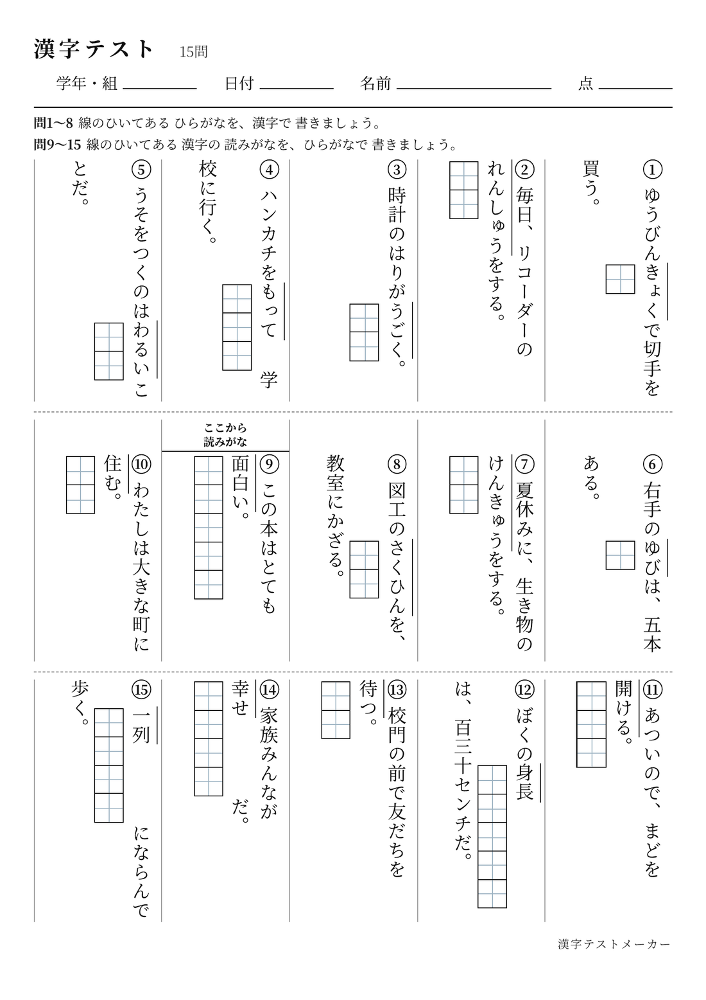

# 漢字テストメーカー

小学校の漢字テストを、縦書きの用紙（A4／レター／A3・問題用／解答用）としてその場で作って印刷できる、ブラウザだけで動くツールです。レターは、アメリカなどでよく使う用紙（縦・横）です。

- 学年から自動で出題／自分で入力／写真・AI・貼り付けから取り込み
- 7つの題型：書き・読み・文中の□・送りがな・練習マス・なぞり書き・自由入力
- 「筆順練習プリント」：漢字を入力すると、書き順の番号・読み・なぞり書きと書き取りのマス入りの練習プリントを作成（データは KanjiVG／KANJIDIC2／常用漢字表）
- 入力内容は利用者のブラウザ内（localStorage）にだけ保存されます。サーバーには送信しません
- 写真の文字認識（OCR）は Tesseract.js を CDN から読み込み、ブラウザ内で処理します

使い方：公開ページを開くだけです（インストール不要）。
ローカルで動かす場合は、このフォルダで `python3 -m http.server` を実行して表示します。

ストア用のアプリは、まだ公開していません。用意しているものと、公開前に自分で行うことは `docs/app-release.md` に書いてあります。応援のリンクは `config.js` の `SPONSOR_URL` が空のあいだは、画面に出ません。

## 15問の見本

小学3年・15問（書きと読み）を、A4縦の問題用紙にしたものです。

記事などに載せる広い画像は `samples/sample-15-questions-medium.png`（幅 1600px）です。

`REVIEW_NOTES.md`／`STAGE_NOTES.md`／`reviews/` は開発中の確認記録です（評価者は AI）。

## 更新履歴

- **2026-10-29**：作ったテストと筆順練習を、名前をつけてこの端末に保存できるようにした。開き直し、名前の変更、コピーして編集、削除、もう一度の印刷ができる。一覧はファイルで別の端末へ移せる。一度開いたあとは、ネットがなくても使える。
- **2026-10-29**：用紙に「レター縦」「レター横」（米国でよく使う大きさ）を追加。A4・レターとも、文字と出典が紙の端で切れない余白にした。15問を選んで開き直すと10問に戻ること、筆順のプレビューが開き直すと消えることを修正。画面は「日本語 / English」で切り替えられ、日本以外で用紙をまだ選んでいないときはレター縦から始まる。マスがおよそ6.5mmより小さくなりそうなときは次のページに分ける。広い画面では印刷まわりのボタンを1行に収め、「作りました」の案内が中身に重ならず、数秒で消えるようにした。詳しくは更新履歴。
- **2026-10-04**：新機能「筆順練習プリント」を追加（KanjiVG／KANJIDIC2／常用漢字表のデータを使用、出典と確認範囲は作成画面に記載）。読みは常用漢字表に載っているものだけを表示。書き取り・なぞり書きのマスをできるだけ大きく、複数字のページ分けを均等に改善。
- **2026-09-23**：答えを書くマスを、問題の文字より大きくできるように改善（問題文の文字サイズは変えず、マスだけ拡大）。答えが見えてしまう／マスが小さいときに印刷前の確認画面を追加。練習マス・なぞり書きのマスの高さをそろえた。送りがなの説明を分かりやすくした。文中の□の読みがな既定をオフに（送りがなは維持）。学年・組／日付の既定をオンに。用紙サイズのおすすめを実測ベースに改善し、極端に問題数が多いときのレイアウト崩れを修正。
- **2026-09-22**：iPhoneで届いた指摘を修正（入力中はタブ帯を隠す、読みがなと□の重なり、印刷ボタンが反応しないアプリ内ブラウザへの案内、送りがなの入力ゆれに対応）。問題の種類ごとに、入力欄へその場で説明を出すようにした。
- **2026-09-21**：問題の種類が変わるところに見出しを追加。種類が入り混じるときの説明文、学年「小学1〜2年」、問題数「15問」などを追加。
- **2026-09-20**：問題の種類をカードの絵で選べるように変更。送りがな・練習マスの表示を改善し、答えが見えてしまう出題を減らした。
- **2026-09-19**：初回公開。
